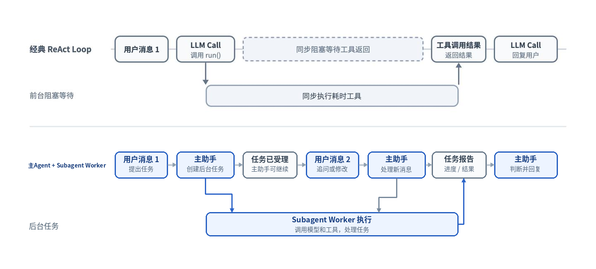
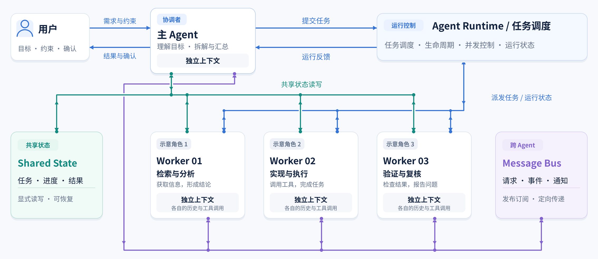
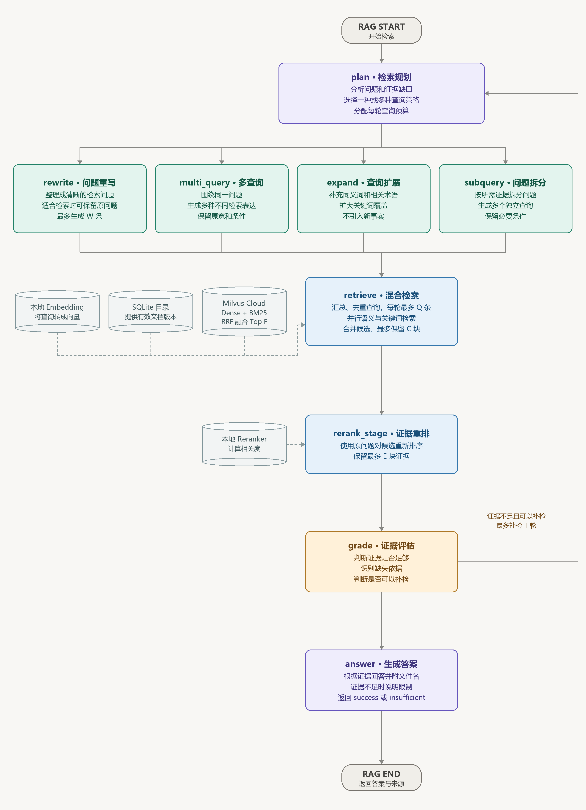

# OpenWorkBot

## 1.项目介绍

OpenWorkBot 旨在打造类 OpenAI Dots 的自主智能员工,面向个人与企业提供主动执行、多智能体协同、长期记忆与工作流自动化能力,构建可自主规划、调用工具、根据反馈调整执行的 Agent 协作系统。

## 技术栈

| 层 | 选型 |
| --- | --- |
| 前端 | React 19 · TypeScript（严格模式）· Vite 8 · Tailwind CSS v4 · React Router 7 |
| 后端 | Python 3.11 · FastAPI（全异步）· uv · LangChain · LangGraph |
| 数据 | SQLAlchemy 2.0 Async + SQLite（当前）或 PostgreSQL（可配置） |
| 模型 | Ollama 本地、OPENAI API、智谱 GLM API 、 DeepSeek API|
| 记忆 | 按用户隔离的 JSON 分类摘要 + Markdown 事实 |
| RAG | MCP + Milvus Cloud + dense + BM25  + RRF|
| 重排 | llama serve Qwen3 Reranker GGUF； Embedding 使用 llama serve Qwen3 GGUF|
| 观测 | Python 标准日志与滚动文件 · 模型调用 JSONL 快照 ·  Langfuse RAG 追踪 |

## 2.系统架构

项目采用主Agent与后台 SubAgent Worker协作的架构：
- 主助手负责与用户交互、理解意图、协调以及简单任务。
- SubAgent Worker 负责执行复杂或耗时的工作，并将进度和结果反馈给主助手。
- 将对话从一问一答的半双工模式转变为全双工模式


### 2.1 Multi-Agent 协作架构

- Shared State + Message Bus


### 2.2 Memory 长期记忆
- memory.json：
  - 快速了解用户的整体背景，保存用户的工作背景、个人情况、当前关注、思考方式、近期背景、更早背景和长期背景七类摘要。
- <事实ID>.md：(最多100条)
  - 针对当前问题选择细节，记录纠错, 每个文件保存一条具体事实，包含正文、类别、置信度、来源和时间等信息。

**长期记忆提取:  主 Agent 静默30s(最长防抖300s)之后**
```
历史对话筛选：上次提取之后的内容
├─ 保留：用户原文、可见的助手最终回复（超长则截取首尾）
├─ 过滤：工具调用与结果、内部消息、中断或失败的回复
├─ 过滤：纯上传、用户纯确认及其对应回复
└─ 规则检测：纠错、偏好、身份、目标等信号，作为提取提示
        │
        ▼
大模型提取记忆
├─ 输入：现有记忆 + 新增对话
└─ 输出：摘要更新 + 新事实 + 建议删除的旧事实
        │
        ▼
大模型结果校验
├─ 解析结构化输出
└─ 规则校验：用户范围、长期有效性、描述性标签、置信度、去重
        │
        ▼
备份回滚更新：中断后恢复
└─ 备份旧文件 → 写恢复日志 → 更新摘要和事实文件
```
**读取并召回长期记忆:  主 Agent 处理用户消息前**
```
确定本次查询内容
├─ 用户消息 → 使用对应的用户原文
└─ 后台报告 → 使用报告所属的任务目标
              │
              ▼
读取当前用户的记忆文件
├─ memory.json           分类摘要
└─ <事实ID>.md            逐条事实
              │
              ▼
给记忆文件排序+筛选+组装
├─ 相关性：分词、词语匹配、稀有词权重
└─ 置信度：提取时由模型给出的分数
```

**记忆纠错：规则识别 + 提示词 + 程序校验**
1. **规则识别：** 检查用户消息是否包含“不对”“你理解错了”“改用”等纠错表达。
2. **提示模型：** 模型判断是否值得长期记住；只有错误原因明确时才填写 `sourceError`。
3. **程序校验：** 程序校验模型给出的用户范围、长期有效性、描述性标签和置信度，才会保存

### 2.3 Task System 任务系统

- 任务状态与对话解耦，变成独立、可持久化的 Agent State，来管理复杂的多步骤目标 
- 通过 Middleware 构建一个「规划 → 执行 → 检查 → 修正」的动态规划闭环, 防止任务漂移

1. **模型自主规划**：Agent 自己规划/修正任务, 根据用户目标决定是否拆分任务, 简单任务直接处理
2. **状态持久化**：保存在 GraphState 的 state.todos 中
3. **上下文压缩恢复**：当聊天历史被压缩时，重新向模型展示当前 任务 状态


### 2.4 上下文压缩

**MicroCompact**
- 超长 tool 结果落盘，模型收到首尾预览和对应路径，后续可分段读取

**Sumary Compact**
- 结构化压缩, 使用当前模型，将已有摘要和较早的对话、工具调用及结果生成新摘要
- 系统提示词, Skills, 工具描述, TODO任务状态, 长期记忆等独立维护，不参与压缩。压缩前会提取长期记忆。
- 保留最近 N 条消息(默认20条)，保持工具调用和结果配对；保留最新用户请求, 预算不足时可减少保留条数
- 触发条件：大于0.8m tokens；消息数达到 200 条；估算输入达到模型上下文窗口的 80%。(均可配置)


### 2.5 短期记忆

- 基于 LangGraph `GraphState + Checkpoint` 保存每个 Agent 的短期上下文
- 业务SQL表保存用户可见聊天、任务、审批和消息投递等记录

```text
短期记忆
├─ Checkpoint: GraphState：每个 Agent 独立维护
│  ├─ messages：用户、助手消息及工具调用和结果
│  ├─ summary_text：历史上下文摘要
│  └─ todos：当前 Agent 的任务清单
│
└─ 业务数据SQL表
   └─ session
      ├─ 保存用户聊天会话、版本、序号和重置状态
      │
      ├─ message
      │  └─ 保存用户可见消息的正文、角色、状态和附件
      │
      └─ part
         └─ 保存任务、审批、消息投递和工具执行等业务记录

PostgreSQL
├─ checkpoints：记录每次存档，以及 State 各字段使用的版本
├─ checkpoint_blobs：保存消息、TODO 等字段的具体内容
├─ checkpoint_writes：保存执行过程中的中间结果，用于恢复
└─ checkpoint_migrations：记录 LangGraph 表结构版本
```

### 2.6 Sandbox 沙箱隔离

```text
Agent Runtime：管理用户运行时和后台任务调度
  │
  ├─ 主 Agent：LangGraph create_agent
  └─ 后台 SubAgent Worker：LangGraph create_agent
       ├─ 权限与审批: 判断工具调用是否允许执行
       └─ SandboxMiddleware: 获取并绑定沙箱
            │
            └─ 沙箱工具：bash、read_file、write_file、str_replace、ls、glob、grep
                 │
                 ├─ AioSandboxProvider: 沙箱租约与生命周期管理
                 │    └─ LocalContainerBackend
                 │         └─ 创建、检查、回收 Docker 资源
                 │
                 └─ AioSandbox
                      └─ agent-sandbox SDK / HTTP
                           └─ 代理认证中继 → AIO 沙箱容器
```

**分层架构**：
- SandboxMiddleware：在 Agent 执行期间获取沙箱，让工具能够找到对应的执行环境。
- SandboxProvider：按用户管理沙箱的创建、获取、释放和复用。
- Sandbox：提供统一的命令执行、文件读写、目录访问能力。

**生命周期管理**：
- 延迟初始化(懒加载)：如果 Agent 只需要回答问题、不调用文件或命令工具，就不必启动沙箱, 避免资源浪费。
- 用户级复用：每用户一组容器：一个 AIO 沙箱容器 + 一个代理容器, 主 Agent 和 SubAgent 共享。
- 空闲回收: 默认空闲 600 秒后回收，容量紧张时可能提前回收。
- Warm Pool：所有租约释放后，正常的容器进入热态，供同一用户后续复用。

**沙箱通信与网络**：
- 工具调用: Agent → 沙箱工具 → agent-sandbox SDK → 代理容器 → AIO HTTP 服务。
- 访问公网: AIO 容器 → 代理容器 → allowlist 中的公网域名
- AIO 容器负责执行命令和文件操作，出网规则集中交给代理控制。

**文件挂载与资源**：
- 用户工作区以可读写方式挂载；容器回收后，工作区文件仍保留在宿主机。
- 资源限制： 1 GiB / 1 CPU / 512 PIDs

### 2.7 权限

| 判断结果  | 含义                      |
| ----- | ----------------------- |
| allow | 允许，直接执行工具               |
| deny  | 拒绝，不执行，将拒绝原因回填模型        |
| ask   | 等待用户审批；批准后执行，拒绝则将原因回填模型 |

| 权限模式        | build 变更前确认 | edit 自动编辑 | yolo 完全访问 |
| ----------- | ----------- | --------- | --------- |
| 读取工作区文件     | allow       | allow     | allow     |
| 写入、编辑工作区文件  | ask         | allow     | allow     |
| 删除文件、执行一般命令 | ask         | ask       | allow     |
| 命中硬拒规则      | deny        | deny      | deny      |

| ask选项                                        | 含义                       | 是否保存规则                    |
| -------------------------------------------- | ------------------------ | ------------------------- |
| Allow once（允许一次）                             | 只批准当前这次工具调用              | 不保存长期规则                   |
| Always allow in this conversation（在此对话中始终允许） | 批准当前调用，后续在当前会话中匹配的操作不再询问 | 只保存在内存，不写入项目规则；重启或新建会话不保留 |
| Deny（拒绝）                                     | 不执行当前调用，拒绝原因回填模型         | 不添加永久拒绝规则                 |

### 2.8 幂等 出错 恢复 (TODO)
模型调用失败
无法连接llm


## 5. 通过 MCP 接入 LangGraph RAG 知识库

RAG 作为独立 MCP 服务，由后台 Worker 调用。LangGraph 按问题规划查询，通过 Milvus 稠密向量和 BM25 混合检索、本地重排及证据评估生成回答；证据不足时并通过 Grounding 反馈加入了 Reflection/自我纠错进行补检。

### 5.1 离线构建

1. **结构化解析**：提取 带层级关系的 Structured Document JSON: 保留来源,名称,格式,标题层级、段落、表格、页码和顺序。
2. **清洗**：去除重复的页眉页脚和多余空白，保留数字、日期、否定词及表格关系。
3. **切块**：先按标题、章节和段落切分；超过上限时再拆分500/50重叠。每个 Chunk 保留标题层级关系。
4. **建立索引**：标题与正文参与 Embedding，写入 Milvus 稠密向量和 BM25 索引。

### 5.2 在线检索



1. 根据问题重写, 多查询, 查询扩展, 问题拆分等RAG增强策略, 每轮最多 6 个子查询；
2. 稠密检索和 BM25 各取 20 条，经 RRF 融合后每个查询保留 10 条；
3. 共 60 条合并去重后Top 20 条重排，聚合取 Top5 父Chunk供证据评估和回答。

### 5.3 回退降级

比如LLM的APIConnectionError

1. 指数退避策略 重试3-5次
2. 查询转换全部失败或为空时使用原问题
3. 使用规则进行降级

### 5.4 RAG 测评结果

| 指标                 |                                    基线结果 | 作用    |
| ------------------ | --------------------------------------: | ----- |
| 文档 Recall\@10      |                          0.880 --→ 1.00 | 找全了没  |
| 文档 NDCG\@10        |                         0.776 --→ 0.886 | 排序好不好 |
| Faithfulness       |                         0.710 --→ 0.970 | 有没有编造 |
| Answer Correctness |                         0.473 --→ 0.802 | 回答对不对 |
| MCP 平均延迟 / P95     | 28.09 秒 / 35.47 秒 --→ 32.25 秒 / 43.27 秒 | 响应时间  |

- 生成为 gpt-6-luna；测评为 gpt-6.1-terra

### 5.5 RAG 测评脚本

```bash
# 1.启动模型
cd C:\Users\nnnnnn\Desktop\OpenWorkBot
.\rag\.venv\Scripts\python.exe .\rag\run_models.py
# 2.上传知识库
.\rag\.venv\Scripts\python.exe .\rag\evaluations\utils\upload_bank_rag.py
# 3.检索评测
.\rag\.venv\Scripts\python.exe .\rag\evaluations\evaluate_retrieval.py --dataset .\rag\evaluations\benchmarks\bank-rag-v2-50.jsonl --limit 50
# 4.生成评测
.\rag\.venv\Scripts\python.exe .\rag\evaluations\evaluate_generation.py --evidence .\rag\evaluations\result\retrieval_11-05-18-50.json --limit 50
```

## 项目启动

需要 Python 3.12+、uv 和 Node.js, 配置 `backend/.env`，然后启动：

```bash
uv run --no-project start.py

# 默认sqlite, 如使用postgresql数据库
docker compose --env-file backend/.env up -d
docker compose --env-file backend/.env ps
```
