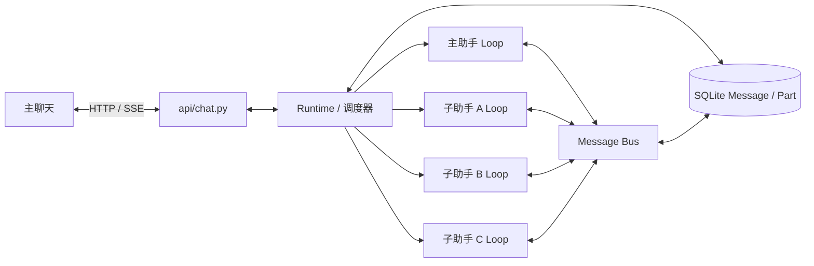
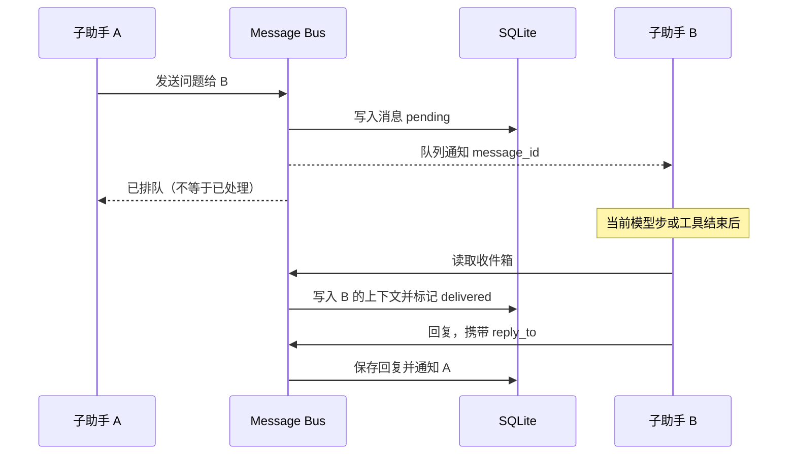

# 多助手运行时与通信设计（待审批）

本文是拟实施的代码设计，不代表功能已实现。用户交互、授权和运行边界以 [multi-agent-design.md](multi-agent-design.md) 为准；开发前需审批。

## 1. 技术选型

沿用 Python 3.12、FastAPI、Anthropic 异步客户端、SQLAlchemy、SQLite、React 和 SSE；主助手与子助手使用同一模型配置，各自维护上下文；并发使用标准库 `asyncio`。不引入 LangGraph、Celery、Redis、新任务表或 Hermes 的完整 Kanban。

| 组件 | 本项目中的职责 |
| --- | --- |
| Orchestrator | 主助手持续对话、理解意图、判断及分配协调任务，实际任务由子助手执行；`Runtime` 中的确定性调度器负责队列、三个槽位、生命周期和权限边界。 |
| Message Bus | 进程内 `asyncio.Queue` 唤醒目标上下文；消息先写 SQLite，队列只传消息 ID。子助手间直接通信，不经主助手模型转述。 |
| Shared State | 复用现有 SQLite 的 `Message` / `Part` 保存任务、各助手上下文、消息状态和审批；数据库是重启恢复的依据。 |
| Structured Messages | 每条内部消息标明来源、目标、任务、上下文、运行及关联请求，防止助手复用时错投。 |



`Runtime` 属于 FastAPI 应用的 `lifespan`，由 `app.state` 持有；同一数据目录仅支持一个后端进程，不能依赖多进程共享内存。关闭网页不关闭 Runtime，进程重启按持久状态恢复。三个子助手是最多三个执行槽位；槽位可复用，任务上下文不随槽位复用。

启动先初始化状态和接口，不等待模型网络调用；缺少模型配置时主聊天仍可加载，未完成任务保留为可恢复状态并报告配置问题。旧多会话历史不迁移，也不自动清空 `backend/data/`。

## 2. 拟改动的代码结构

以下路径和接口是设计，不是现有实现；新模块只承载直接需要的职责。

| 文件 | 职责或改动 |
| --- | --- |
| `backend/app/main.py` | 启动数据库后创建 `Runtime`、恢复工作并注入 `app.state`；退出时关闭模型流和后台任务。 |
| `backend/app/api/chat.py`（新） | 提供 `/api/chat` 快照、消息、审批和 SSE；只调用 Runtime，不直接执行模型。替换旧会话路由。 |
| `backend/app/agent/runtime.py`（新） | 持有主助手、最多三个子助手槽位、任务队列、任务状态、停止信号及后台任务引用；串行化调度决策。 |
| `backend/app/agent/agent_bus.py`（新） | 内部消息收发、持久状态核对与重试、显式回复等待及已知等待环检测；不负责模型推理。 |
| `backend/app/agent/task_tools.py`（新） | 提供主助手与子助手的结构化工具 schema 和异步分发；实际状态修改委托 Runtime / Bus。 |
| `backend/app/agent/loop.py` | 主助手对话、直接回答简单问题、判断及任务分配协调；新输入中断当前回复，处理任务报告。只调用任务管理及记录查询工具，不直接执行调查、业务分析、文件和命令等实际工作。 |
| `backend/app/agent/subtask.py` | 改为独立的子助手循环：每次执行最多 30 步，在安全边界接收消息，结束时异步汇报。 |
| `backend/app/agent/system_prompt.md` | 描述主助手如何分配、判断和关联任务，默认简短回答；子助手提示词同步增加通信和权限边界。 |
| `backend/app/models.py` | 为内部消息的类型、处理状态及下次重试时间建立查询索引，空库创建，无需新增表。 |
| `backend/app/sessions/store.py`、`replay.py`、`recorder.py` | 短事务保存内部状态和各上下文；将现有 `TurnRecorder` 的长持有 Session 改为事务内创建；分别投影用户聊天与指定助手历史。 |
| `backend/app/sessions/approvals.py` | 一个主会话下管理多个任务审批；实现暂缓、撤销和恢复，沿用 `permission_service.py` 与 `session_permissions.py`。 |
| `backend/app/agent/compact.py`、`llm.py`、`tools.py` | 按上下文压缩输入副本；支持指定路由工具；实现已确认的文件分页和命令输出上限。 |
| `backend/app/agent/model_call.py`、`backend/app/modelio.py` | 将模型调用关联到上下文及运行；日志写入和轮转串行化，失败仍只告警。 |
| `frontend/src/api/client.ts`、`hooks/useSessionStream.ts`、`types.ts`、`App.tsx` | 接入主聊天接口、按消息 ID 和版本更新；页面保留主聊天、权限模式输入和任务关联审批。 |
| `backend/tests/`、前端验证 | 更新旧接口相关测试；用假模型和临时空库验证并发、通信、权限、恢复与 SSE。 |

原 `turn_manager.py` 的“每会话仅一个活跃轮次”和 `subtask.py` 的父轮次同步等待不再作为任务调度依据；旧调用方和测试随接口一起调整。

## 3. 运行时与调度接口

以下为职责接口示意，具体 Python 类型在开发时按项目现有风格实现：

```text
Runtime.start() / close()                         # 初始化、恢复、关闭
Runtime.accept_user_message(client_id, text, mode) # 保存输入并唤醒主助手
Runtime.create_task(call, goal, title)             # 创建或入队，立即返回 task_id
Runtime.update_task(call, task_id, instruction)    # 发送给负责人和活跃协助者
Runtime.stop_task(call, task_id)                   # 持久化停止意图，协作式停止
Runtime.review_task(call, task_id, decision, instruction?) # continue / complete / fail
Runtime.wait_dependency(call, task_id, dependency_id) # 等待依赖并在安全边界让位
Runtime.request_help(call, goal)                   # 仅分配空闲槽位
Runtime.finish_run(context_id, run_id, status, result) # 原子保存结果并通知接收方
MessageBus.send(call, target_context_id, kind, content, reply_to?)
MessageBus.receive(context_id) / wait_reply(context_id, message_id)
```

`Runtime` 的进程内状态包括：写锁、`task_id → 创建序号` 的待分配集合、`slot_id → 执行上下文 / asyncio.Task`、主助手当前回复任务、主助手输入 / 报告队列，以及 `context_id → 消息 ID 队列`。这些是数据库的运行时索引，不是唯一事实来源；重启时从 SQLite 重建。

```text
有空闲槽位时：
  收集 queued 任务；沿已确认的依赖链，以最早等待任务的序号加入可领取依赖
  已运行或等待用户的依赖不重复领取
  按序号选候选；若有更早的 reviewing 任务则等待判断
  如有候选，在锁内写入领取与 run_id（续接沿用原 ID），提交后启动子助手
```

- `call` 是运行时注入的 `{context_id, run_id, tool_call_id}`，不由模型填写。主助手可调用创建、查询、修改、停止和结果判断工具；子助手可查看同伴状态、发消息、请求协助、等待回复和报告关键事项。运行时从调用上下文确定发送方，模型不能自报发送方或伪造用户批准。
- 创建任务时分配稳定 `task_id` 和创建序号。调度器在同一把锁内检查空闲槽位、按创建序号选队首、持久化负责人及 `run_id`；续跑沿用原序号。较早任务处于 `reviewing` 时，较晚任务等待主助手判断后再分配；已运行的任务不被抢占，因此空闲槽位可能暂时闲置。已有用户任务排队时优先于助手间额外协助；无空闲槽位时协助请求立即返回不可分配，请求方自行继续。
- 子助手发现任务依赖时通过 `task_report` 请求主助手判断。主助手确认 A 等待 B 时，校验任务并持久化 `task-A → task-B`，将 A 标记为 `waiting_dependency`；运行中的 A 在当前模型步或工具结束后保存上下文并让出槽位，已有协助可继续。B 可先于 A 续跑领取；B 完成后结果送主助手判断并恢复 A，B 失败或停止时通知主助手处理；A 已停止则不恢复。暂停同一轮保留 `run_id` 和步数；A 已进入 `reviewing` 时由主助手决定新一轮。依赖与用户审批分别记录，等待审批的执行单元仍占槽位；已开始的工具不会因让位被强制重跑或中断。
- 子助手达到 30 步或主动结束时，先保存执行状态和结果，再投递主助手判断；第 30 步正常结束可汇报结果，只有还需下一步才算步数耗尽，不能当作成功。主助手可立即发起新一轮，步数重新计数；判断持续重复且无进展可停止。任务完成前须收口相关协助。
- 不同上下文可并行，但同一上下文同一时刻只能有一个模型调用；每次模型调用开始前持久化本轮已用步数。重启恢复同一轮时保留步数，只有主助手发起新一轮才重新计数。
- 主助手的任务工具和子助手的消息工具是 `async` 内部调用；现有文件 / PowerShell 工具仍经过权限检查，再由 `asyncio.to_thread` 执行，不能在线程中共享 SQLAlchemy Session 或直接操作 `asyncio.Queue`。命令用 `Popen` 将 stderr 合并到 stdout，由读取线程持续排空并保留限额内首尾，外层等待超时；读取线程不能无限阻塞，输出未收全时明确标记。工具结果回到事件循环后再落盘和投递。
- 主助手由 Runtime 的单个消费循环驱动：用户输入优先，空闲时由待处理任务报告唤醒并判断；报告在主助手回复用户期间只排队。子助手运行任务由 Runtime 独立 `create_task` 并持有引用，不随主回复取消。

例如：A 达到 30 步进入 `reviewing`，B 已排队时，即使有空闲槽位也先等主助手判断；判断 A 继续则按 A 原序号分配新一轮，判断 A 完成则分配 B。已在运行的其他任务不抢占。

拟提供给模型的工具（这些名称为设计草案）：

| 工具 | 可用角色 | 参数与结果 |
| --- | --- | --- |
| `task_create` / `task_inspect` | 主助手 | 目标、标题 / 任务 ID；返回任务 ID、状态和可查询的工作记录。 |
| `task_update` / `task_stop` | 主助手 | 任务 ID、变更内容 / 任务 ID；返回已受理，实际送达和停止另行记录。 |
| `task_review` | 主助手 | 任务 ID、`continue / complete / fail` 及说明；继续时入队，完成前检查协助是否收口。 |
| `task_wait_for` | 主助手 | 任务 ID、依赖任务 ID；返回已受理，实际暂停及恢复另行记录。 |
| `route_input` | 主助手 | 用户消息 ID 与任务意图；待审批存在时由模型先调用，用于恢复或撤销审批。 |
| `agent_list` / `agent_send` | 子助手 | 查看当前同伴状态；向指定上下文发送文本、可选 `reply_to` / 重要标记，返回消息 ID。 |
| `agent_wait` / `agent_help` | 子助手 | 等待指定消息的回复 / 请求空闲助手协助；无空闲槽位或用户任务优先时，协助请求立即返回未分配。 |
| `task_report` | 子助手 | 报告关键进展、需要主助手决策或用户回答的事项；结束、失败和 30 步耗尽由运行时自动汇报。 |
| `read_tool_output` | 主助手、所属任务的子助手 | 按任务、输出记录 ID 和范围查看已保存的输出片段。 |

`agent_list` 只返回同伴标识、任务摘要和忙闲状态；工具返回“已受理”不等于消息已送达或任务已停止，主助手须等相应状态再向用户报告。

## 4. 助手间通信

一个消息的持久记录示例，字段名和类别为待审批的接口约定：

```json
{
  "type": "agent_message",
  "version": 1,
  "task_id": "task-A",
  "message_id": "m-1",
  "source": {"task_id": "task-A", "context_id": "ctx-A", "run_id": "run-A1"},
  "target": {"task_id": "task-B", "context_id": "ctx-B"},
  "kind": "question",
  "content": "请告知接口路径。",
  "reply_to": null,
  "important": false,
  "status": "pending"
}
```

`task_id` 表示来源任务，接收目标可属于另一任务；`Part.sequence` 记录入队顺序。目标按 `context_id` 路由，而不是只按可复用的槽位编号；跨任务询问同时保存来源和目标任务 ID。主助手使用固定主上下文；结束或更换运行后，已接受的消息按上下文恢复，迟到的旧运行结果不得覆盖新运行。



- 收件箱按目标上下文独立；活动上下文使用队列，未激活上下文只保留持久消息。队列通知不是消息事实；Runtime 启动、收件方空闲 / 中断时及定时通过索引核对 SQLite 中未处理消息，重建丢失的通知。
- 正在工作的 B 可以接收信息询问，但只在当前模型调用或工具完成后的安全边界处理；B 忙时不接额外工作。A 发出问题后可继续工作，只有显式等待回复时才等待；等待回复或审批时同时监听停止和变更信号，不并行启动该上下文的另一轮模型调用。
- 等待回复先按 `reply_to` 查询已保存结果；尚无回复时，在同一锁内登记等待并再次检查，再等待通知，避免回复恰好先到而永久等待。消息在模型历史中标明来源任务和上下文；消息正文不能作为用户授权或运行时控制信号。
- 子助手循环按“检查停止 / 投递收件箱 → 组装本上下文 → 调用模型 → 按序执行工具并保存结果”推进；每次工具结束才进入下一安全边界。等待被停止、变更或依赖暂停打断时，先为当前工具调用补齐结果，再处理新消息。
- `pending → delivered → processed` 分开记录：写入目标上下文与 `delivered` 同事务；处理结果落盘后标记 `processed`。消息 ID 由调用身份和接收上下文确定；一次操作投递多个目标时，每个目标有独立 ID；运行结束等自动消息使用稳定运行 ID 生成事件 ID。重启补投时，已 `delivered` 的消息从原上下文继续处理，不再重复插入。
- 借鉴 DeepSeek 的持久化待处理与重试：`agent_message` 保存重试次数及下次时间，通知失败按有界退避重试；主助手回复被打断时，已投递但未处理的报告保留原状态，处理完新用户消息后继续处理，不重复插入上下文。只重试内部消息投递和报告处理，不自动重跑外部命令或文件操作。
- 默认只把任务结果、失败、需要决策或确认的事项送主助手；子助手可标记重要消息。普通同伴消息保存在各自上下文，不自动拼入主对话。修改消息与助手结束并发时，以锁内提交顺序为准；如果已受理但没有安全边界送达，保留未送达记录并通知主助手判断是否续跑。

负责人结束的调用链：`subtask.py → Runtime.finish_run → MessageBus → 主助手 loop.py → task_review → 主聊天 SSE`；协助者的结果先直接投递给请求方，再按上述类别规则通知主助手。`finish_run` 同事务保存结果和待投递通知，不能先释放结果再持久化。

## 5. 存储与恢复

沿用 `Session.id = "main"`；在该会话下增加内部标记的 `Message` / `Part`，不新增表。普通用户消息仍保存为可见消息；内部执行消息带 `context_id` 和隐藏标记，`load_history` 按上下文读取，`load_replay` 仅投影用户可见内容。

拟使用一个隐藏控制 `Message` 保存内部状态的 `Part`：稳定 ID 分别使用 `task:{id}`、`context:{id}`、`run:{id}`、`message:{id}`、`approval:{id}`；用户可见的消息和各上下文的模型消息仍各自使用独立 `Message`。可见事件的版本也保存在控制 `Part` 中，并和对应消息变更同事务提交。

| `Part.data.type` | 稳定身份与主要字段 |
| --- | --- |
| `task_state` | `task_id`、目标、创建序号、根状态、负责人、`run_id`、依赖任务、停止意图 |
| `agent_context` | 稳定 `context_id`、所属任务、负责人 / 协助者和摘要边界 |
| `agent_run` | `context_id`、`task_id`、`run_id`、本轮步数和执行状态 |
| `agent_message` | 消息 ID、来源、目标、类型、内容、关联请求、投递 / 处理状态、重试次数及下次时间 |
| `approval` | 请求 ID、任务 / 运行 / 调用 ID、参数快照、授权范围、审批状态及暂缓关联的消息 ID |
| `file_wait` | 规范化真实路径、占用任务、等待执行单元及等待关系 |

主对话、每个负责人、每次协助各有独立 `context_id`；模型步骤的文本和工具调用按上下文保存，读取时在 SQL 中筛选上下文。摘要只替换模型输入副本；保留工具调用及其结果的配对，原始已采集结果不因压缩被覆盖。

所有状态写入经过 Runtime 的 `asyncio.Lock` 和短 SQLite 事务，事务内创建独立 Session；不持锁等待模型、命令或用户。任务创建与工具受理结果、消息落盘与状态变更、接收方上下文与投递标记分别原子提交；按上下文、运行和工具调用 ID 去重。

`task_tools.py` 将运行时注入的调用身份传给 `Runtime`；例如 `task_create` 必须在同一事务中写入任务和该工具调用的受理结果，不能先返回再保存，避免重启后重复创建。同一调用 ID 重试时，参数一致返回已保存结果，参数不同返回冲突。恢复同一轮时保留 `run_id` 和已用步数；主助手决定续跑才创建新的 `run_id`。

命令工具结果同时保存受限原始输出和输出记录 ID；模型收到不超过 3 万字符的首尾预览、截断提示和记录 ID，可调用 `read_tool_output` 分段读取已保存部分。超过 1 MiB 未采集到的内容无法读取或恢复。

| 中断位置 | 恢复行为 |
| --- | --- |
| 消息已提交，队列通知未送达 | 启动时从数据库重建通知；恢复同一轮时沿用原 `run_id`，新一轮才生成新 ID。 |
| 已写入目标上下文，尚未处理 | 不重复插入消息，继续处理未完成事项。 |
| 命令已开始、结果未提交 | 保留工具调用并补入“结果未知”，由子助手先检查；不自动重跑，不保证外部命令恰好执行一次。 |
| 任务已完成、结果未转达 | 投递已保存结果，不重新执行任务。 |
| 等待用户审批 | 先恢复未分类消息及审批暂缓关系，再按现有权限重新判断并以新 ID 发起未完成审批；原先暂缓的审批仍不可提交，直到相关消息均分类。会话授权重启后失效；已批准但未开始的操作重新检查权限，已开始则按结果未知处理。 |

## 6. 更新、审批与冲突

- 用户新消息先保存并通知主助手；只中断主助手当前回复，后台任务不受该中断直接影响。子助手任务由 Runtime 独立持有，不归属于主回复的取消范围。主助手处理用户输入优先于待转达的后台报告；已显示的部分先落盘并标记中断，旧轮次迟到输出不能覆盖新回复。
- `accept_user_message` 在写锁内保存上一回复已缓冲正文并标记中断、推进主回复代号、写入用户消息并暂缓当时的待处理审批；提交后通知取消旧模型流和唤醒主助手。每次正文落盘和广播前检查代号，拒绝旧流的迟到片段。
- 主助手判断期间，已获授权且无需审批的操作按原规则继续；判断后向相关上下文发送修改或停止。已经开始或完成的操作不承诺撤销。
- 新消息到达时，同事务暂缓当时已有的待处理审批；判断期间新产生的审批仍按现有规则提出（本次设计建议，待审批）。主助手用 `route_input` 分类后，撤销受影响任务及协助者尚未处理的审批，恢复其余暂缓审批。归属不明时原有暂缓继续并向用户询问；已存的会话授权范围和优先级不变。
- 连续用户消息按接收顺序分类；原有暂缓审批须等所有未分类消息处理后才恢复。存在暂缓审批时，`llm.py` 使用 `tool_choice` 指定 `route_input`；模型不支持或结果无效时报告错误并保持暂缓，不能自动授权。
- 新消息与审批暂缓关联在事务中持久化。启动恢复时先重建未分类消息及暂缓关联，再提供快照并启动执行；重新发起的旧审批继承暂缓状态，不当作判断期间新产生的审批。分类完成后按已保存意图撤销或恢复；页面启动不等待模型调用。
- `route_input` 结构示例为 `{message_id, intents: [{type: "update", task_id, instruction}], needs_clarification: false}`；意图类型为 `chat / create / query / update / stop / unclear`。Runtime 校验消息和任务归属后，在同一事务内记录分类、撤销受影响审批并提交对应修改或停止意图，再把已处理结果及 `message_id + 意图序号` 返回主助手；相同意图重试不重复执行。归属不明不提交修改或停止。
- 审批仍先调用 `permission_service.evaluate()`；会话授权仅覆盖 `ask`，不能覆盖硬拒或 `deny`。文件授权按工具及真实路径匹配，命令授权按完整参数匹配；授权仅存当前进程的主会话内。待审批结果返回后重新检查停止、规则及参数快照；主助手的判断不能代替用户批准。
- 子助手触发权限审批时，Runtime 将请求绑定任务并保存后推送到主聊天，用户通过原有选项处理；子助手的业务疑问则以内部消息交给主助手组织提问。
- `write_file` / `edit_file` / `delete_file` 在权限允许后规范化真实路径并协调；首次写操作为所属任务占用该文件至任务结束，同任务协作者按单次操作串行。不同任务等待占用释放；Runtime 记录路径版本，等待结束或发现读取后被其他助手改动时，返回错误要求重新读取和生成参数，不直接执行旧写入。新调用重新进行权限检查，旧调用的单次批准不转移；执行前重新校验路径。命令工具内部影响范围无法可靠识别。
- 显式等待记录为有向边：A 等 B 为 `task-A → task-B`，B 依赖其执行者为 `task-B → ctx-B`，执行者等 A 的文件为 `ctx-B → task-A`；三条边形成等待环。另记录助手间回复等待。让出槽位不释放文件占用；边变化时检查已知环并通知主助手判断，不自动终止；重启后重建关系。

`stop_task` 在事务中写入停止意图并撤销相关待处理审批，再通知负责人和协助者；各循环在模型、工具和审批边界检查停止。已开始的命令按原有协作式规则收口，全部相关执行单元结束后释放文件占用；新消息的变更也按同样的安全边界投递。

服务关闭信号与用户停止任务分开：关闭时保存部分输出和未完成状态，取消模型流并有界等待后台收口；不把任务标记成用户停止。已开始的外部命令可能仍有副作用，重启后按结果未知处理。

## 7. 主聊天接口与事件

| 接口 | 调用与结果 |
| --- | --- |
| `GET /api/chat` | 返回 `{revision, messages, approvals, permission_mode, context_usage}`。 |
| `POST /api/chat/messages` | 接收 `{client_message_id, text, permission_mode?}`，保存后立即返回 202 和消息 ID，不等待模型；相同请求幂等，不同内容复用 ID 返回 409。 |
| `GET /api/chat/events` | SSE 推送 `snapshot`，再推送 `{revision, type, data}`；事件类型 `message / approval / usage`。 |
| `POST /api/chat/approvals/{request_id}` | 接收 `{option_id, feedback?}`；暂缓、失效、已处理或归属不符返回冲突。 |

每个 SSE 连接有独立队列；注册订阅和读取快照在同一写锁内完成。用户可见事件逐个分配持久递增版本，在事务提交后、释放锁前非阻塞入队；慢连接溢出时断开该连接，版本缺口或重连时重新取快照。主助手流式文字分批落盘后推送；新输入优先，后台报告按主助手实际发送时序追加。

## 8. 验证范围

- 使用独立空 SQLite、假模型和临时工作区：三个槽位、旧任务待判断时较晚任务不领取、续跑优先、直接消息与忙碌同伴、无空闲协助、30 步续跑及停止。
- 验证 A 等排队的 B 时安全让位、B 完成后恢复 A，暂停不重置步数；模拟消息已落盘但唤醒失败、回复打断及投递错误，同进程重试不重复插入或重跑外部工具；验证待处理查询使用索引。审批暂缓时重启，重发的旧审批虽有新 ID 仍不可提交，直到相关消息完成分类。
- 注入崩溃点验证消息落盘 / 投递 / 处理、任务创建去重、未投递结果、未知命令结果和审批重发；分别检查主 / 子上下文隔离与工具调用配对。
- 验证新输入打断主回复但不打断后台、审批暂缓与共享授权、文件竞争与等待环、长输出边界、SSE 快照和事件不丢不重。
- 执行前端构建、检查和浏览器验收。真实模型对指定工具调用的支持、任务判断质量，以及 PowerShell 命令不可恰好执行一次的限制单独记录。

本机只读能力检查：SQLite 3.53.1 支持 `json_extract`，已安装 Anthropic SDK 1.8.0 的异步流接口接受 `tool_choice`。当前项目的 `AnthropicStreamClient.stream` 尚未暴露该参数，实际兼容模型是否支持仍需验证。

## 9. 参考范围

- `9a76ac8e4f` 的 `tools/async_delegation.py:1`：后台委派、完成消息先持久化再投递；其普通后台委派不恢复崩溃时仍在运行的子助手。
- `tools/delegate_tool_registry.py:124`：运行中变更先排队，在安全边界接收；接受后未送达的变更需要保留或报告。
- `hermes_cli/kanban_db.py:1`：SQLite 状态与原子领取的思想；本设计不引入其任务表、看板或工作进程框架。
- `tools/bot_mode_dm.py:1` 属于独立 Bot Mode 跨助手通信，不能等同 Hermes 普通委派子助手；本项目的进程内 Message Bus 是自己的精简设计。
- [DeepSeek `6337fc823ce`](https://github.com/deepseek-ai/dsh-superagent-prototype/blob/6337fc823ce20251c8de8085948165c81aaa701e/src/app/effects.ts)：参考 SQLite 先保存待处理项、失败后退避重试；沿用现有 `Part`，不引入其完整队列框架。
